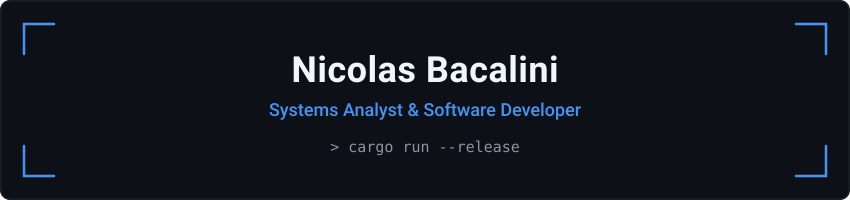

  
    
  
  

- **Backend & Data:** Building APIs and services with **Go**, **Python (FastAPI)**, **PostgreSQL**, and **Redis**.
- **Systems & Low-Level:** Exploring performance-oriented development with **Rust**, **C++**, and **Linux**.
- **Hardware:** Tinkering with microcontrollers, **Arduino**, and embedded prototyping.

- **[Nombre del Proyecto 1](https://github.com/Nicobacalini/repo-1)** — Breve descripción de 1 línea sobre qué resuelve *(Rust / Linux)*.
- **[Nombre del Proyecto 2](https://github.com/Nicobacalini/repo-2)** — Breve descripción de 1 línea sobre qué resuelve *(Go / PostgreSQL)*.
- **[Nombre del Proyecto 3](https://github.com/Nicobacalini/repo-3)** — Breve descripción de 1 línea sobre qué resuelve *(C++ / Arduino)*.

---

  

 

  

